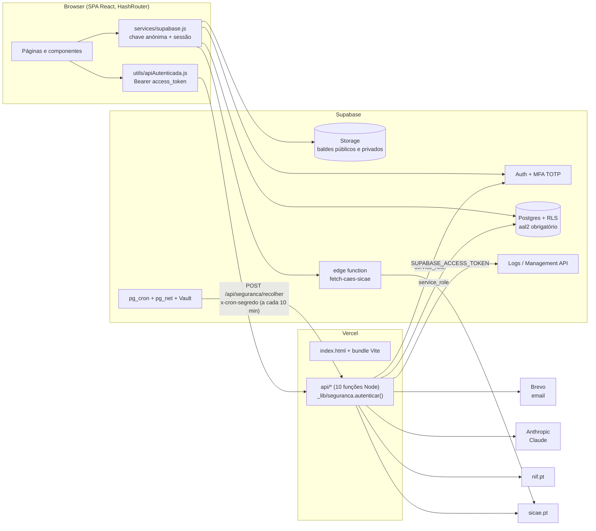

# 01 — Arquitetura

Visão geral do Bizin Manager: o que é, como está montado e por onde passam os dados.
Para instalar e publicar ver [02-setup-e-deploy.md](02-setup-e-deploy.md); para cada rota do servidor
ver [05-api-e-servidor.md](05-api-e-servidor.md); tabelas e RLS em [03-base-de-dados.md](03-base-de-dados.md);
segurança (2FA, cofre, alertas) em [04-seguranca.md](04-seguranca.md); componentes e utilitários
partilhados do frontend em [06-frontend-partilhado.md](06-frontend-partilhado.md); cada módulo
funcional em `docs/modulos/`.

---

## 1. O que é

Aplicação web interna (SPA) para a gestão da empresa: tarefas e agenda, projetos, entidades
(clientes), atividades, comunicação interna (fórum/chat), RH (ausências, férias, pedidos de km,
saldos), marketing (marcas, conteúdos, assistente de ideias com IA, leads, campanhas por email),
TransferGest, propostas comerciais, programas/avisos de financiamento, cursos e ações de formação,
ativos de TI, organizador de PDFs com IA e área de administração/segurança.

Utilizadores: só colaboradores da empresa. **Não há registo livre** — as contas são criadas por
convite no Supabase (Authentication → Invite user). O 2FA (TOTP) é obrigatório para todos.

## 2. Stack

| Camada | Tecnologia | Onde |
|---|---|---|
| UI | React 19, React Router 7 (`HashRouter`) | `src/` |
| Build/dev | Vite via **rolldown-vite 7.2.5** (alias `vite` em `package.json` → `overrides`) | `vite.config.js` |
| Base de dados, auth, ficheiros | Supabase (Postgres + RLS, Auth com MFA TOTP, Storage, pg_cron, pg_net, Vault) | `supabase/migrations/` |
| Servidor (produção) | Funções serverless Node do Vercel (plano Hobby, máx. 12 funções; hoje 10) | `api/` |
| Servidor (dev local) | Express na porta 8787 que reutiliza os handlers de `api/` | `server/index.js` |
| Email | Brevo (API transacional) | `server/brevoCampaignSender.js` |
| IA | Claude via `@anthropic-ai/sdk` (assistente de ideias e organizador de PDF) | `api/marketing/ideias.js`, `api/organizador/ia.js` |
| Edge function | Deno no Supabase (`fetch-caes-sicae`) | `supabase/functions/` |
| Bibliotecas de destaque | recharts (gráficos), leaflet/react-leaflet (mapas km), jspdf/html2pdf/pdf-lib/pdfjs-dist (PDF), tesseract.js (OCR; `por.traineddata` na raiz), jsqr (QR fiscal), xlsx/jszip, emoji-picker-react, lucide-react | `src/` |

Sem TypeScript, sem testes automáticos, sem biblioteca de estado global: o estado vive nos
componentes e em dois contextos React (Auth e Tema).

## 3. Estrutura de pastas

```
/
├── index.html               # HTML base (lang pt-PT, fonte Manrope) → /src/main.jsx
├── vite.config.js           # plugin React + proxy /api → http://localhost:8787 (dev)
├── vercel.json              # rewrites SPA, maxDuration do assistente, cabeçalhos de segurança
├── eslint.config.js
├── .env.example             # modelo de variáveis (o .env real nunca vai para o git)
├── por.traineddata          # dados de OCR português do tesseract.js
├── REFERENCIA_TEMAS.txt     # notas sobre os temas visuais
├── api/                     # funções serverless (cada ficheiro fora de _lib = 1 função Vercel)
│   ├── _lib/                # código partilhado (pasta com "_" NÃO conta como função)
│   ├── admin/[op].js        # /api/admin/mfa | contas
│   ├── notificacoes/[tipo].js
│   ├── seguranca/[op].js
│   ├── marketing/ideias.js
│   ├── organizador/ia.js
│   ├── absence-notifications/action.js
│   ├── nif.js, sicae-caes.js, cae-descriptions.js, health.js
├── server/                  # Express local + módulos usados também pelas funções (Brevo, CAE)
├── scripts/                 # dev-all.mjs, migrar-ficheiros-chat.mjs, sendMarketingCampaign.mjs
├── supabase/
│   ├── config.toml          # só configura a edge function (verify_jwt = false)
│   ├── functions/fetch-caes-sicae/
│   └── migrations/          # 001_… a 078_… (+ variantes 072b, 075b, 077b/c e modulo_ativos_ti.sql)
├── public/                  # logótipos, fundos, pdfjs/ (worker do pdf.js)
└── src/
    ├── main.jsx             # entrada: CSS globais, instalarAberturaSegura(), <AuthProvider><App/>
    ├── App.jsx              # rotas
    ├── context/             # AuthContext.jsx, ThemeContext.jsx
    ├── hooks/               # useAuth.js (reexporta), useTotpEnroll.js
    ├── services/            # supabase.js (cliente único), marketingSender.js, transfergestSender.js
    ├── pages/               # uma página por rota (+ CSS de algumas páginas)
    ├── components/          # Sidebar, ProtectedRoute, diálogos, PDFs, admin/, marketing/, medalhas/
    ├── utils/               # lógica partilhada (ver 06-frontend-partilhado.md)
    ├── constants/           # themes.js, marketing.js (listas usadas também pelo servidor)
    ├── data/                # CSV do catálogo CAE rev.4, frases.js
    ├── styles/              # CSS por área (camadas.css, main.css, motion.css, acessibilidade.css…)
    └── assets/
```

Ficheiros em `src/` que o servidor também importa (não podem usar APIs do browser no topo do módulo):
`src/constants/marketing.js` (por `api/marketing/ideias.js`), `src/utils/pdfOrganizerEngine.js`
(por `api/organizador/ia.js`, para `PDF_CATEGORIES`) e `src/data/CAE rev4.xlsx - Table 1.csv`
(por `server/caeCatalog.js`).

Páginas existentes mas **sem rota**: `src/pages/SignUp.jsx` (registo livre, desativado de propósito).
`PropostasFinanciamento.jsx` e `PropostasFormacao.jsx` não têm rota própria: são usados dentro de
`PropostasComerciais.jsx`.

## 4. Arranque da aplicação no browser

1. `index.html` carrega `src/main.jsx`.
2. `main.jsx` importa os CSS globais (`camadas.css`, `main.css`, `motion.css`, `acessibilidade.css`),
   chama `instalarAberturaSegura()` (`src/utils/ficheirosPrivados.js`: qualquer `<a href>` para um
   balde privado — `rh_anexos`, `documentos`, `chat_ficheiros` — passa a abrir com URL assinado de
   10 minutos) e monta `<AuthProvider><App/></AuthProvider>`.
3. `App.jsx` monta `ThemeProvider > AuthProvider > GlobalTooltipProvider > HashRouter > Routes`
   e, fora do router, `<DialogoGlobal />` (diálogos de confirmação/aviso usados via `src/utils/dialogo.js`).

> Há **dois** `AuthProvider` (em `main.jsx` e em `App.jsx`). Os componentes leem o mais interior;
> o exterior corre em duplicado (pedidos de sessão/perfil e listeners repetidos). Ver secção 10.

## 5. Routing

`HashRouter` → todos os URLs da app têm a forma `https://<domínio>/#/dashboard/...`. Isto é
importante para links em emails (ex.: `api/_lib/notificacoes.js` gera
`<APP_URL>/#/dashboard/pedidos/<id>`) e porque o servidor nunca vê a rota (tudo é `index.html`;
ver `rewrites` em `vercel.json`).

### Rotas públicas

| Rota | Página | Notas |
|---|---|---|
| `/` | `pages/Login.jsx` | Login + passo de código 2FA ou configuração do TOTP |
| `/forgot-password` | `pages/ForgotPassword.jsx` | `supabase.auth.resetPasswordForEmail` |
| `/reset-password` | `pages/ResetPassword.jsx` | Nova palavra-passe (pede código 2FA se a conta tiver) |
| `*` | 404 inline em `App.jsx` | |

### Rotas protegidas (`/dashboard`, layout `pages/Dashboard.jsx` com `<Sidebar>` e `<Outlet>`)

Todas exigem sessão + 2FA verificado (`ProtectedRoute` sem papéis). As que têm papéis indicados
usam um segundo `ProtectedRoute allowedRoles=[...]` (comparação em minúsculas com
`profiles.role || profiles.tipo`).

| Caminho (`/#/dashboard/…`) | Componente | Papéis exigidos |
|---|---|---|
| *(index)* | `DashboardHome` | todos |
| `minhas-tarefas` | `MinhasTarefas` (Agenda) | todos |
| `tarefas` | `Tarefas` | todos |
| `projetos` | `Projetos` | todos |
| `projetos/:id` | `ProjetoDetalhe` | todos |
| `clientes` | `Clientes` (Entidades) | todos |
| `atividades` | `Atividades` | todos |
| `forum` | `Forum` (Comunicação / chat) | todos |
| `rh` | `RecursosHumanos` | admin, administrador, gestor |
| `pedidos/:id` | `AprovarPedido` (link dos emails de ausência; `?acao=aprovar\|rejeitar`) | admin, administrador, gestor |
| `ferias` | `Ausencias` | todos |
| `pedido-km` | `PedidoKm` | todos |
| `perfil` | `Perfil` | todos |
| `leads` | `GestaoLeads` | admin, administrador, gestor, marketing |
| `marketing` | `Marketing` | admin, administrador, gestor, marketing, marketing plus |
| `transfergest` | `TransferGest` | admin, administrador, gestor |
| `ativos-ti` | `AtivosTIDashboard` | admin, administrador, gestor, marketing plus |
| `propostas` | `ListaPropostas` | admin, administrador |
| `propostas/novo`, `propostas/:id` | `PropostasComerciais` | admin, administrador |
| `avisos` | `GestaoAvisos` (Programas/Avisos) | todos |
| `admin` | `AdminDashboard` | admin, administrador |
| `registos` | `RegistoAtividade` (audit log e alertas de segurança; `?alertas=1`) | admin, administrador |
| `modelos` | `components/GestaoTemplates` (modelos de projeto) | todos |
| `cursos` | `Cursos` | todos |
| `acoes-formacao` | `AcoesFormacao` | todos |
| `organizador-pdf` | `OrganizadorPdf` | todos |

Papéis conhecidos (coluna `profiles.role`, espelhada em `profiles.tipo`): `colaborador`, `gestor`,
`marketing`, `marketing plus`, `admin` (`administrador` é aceite como sinónimo antigo). A lista
válida para mudança de papel está em `api/_lib/adminContas.js` (`PAPEIS_VALIDOS`).

**Ao criar uma página nova** é preciso tocar em três sítios: `<Route>` em `App.jsx`, o título em
`PAGE_TITLES` de `pages/Dashboard.jsx` e o link em `components/Sidebar.jsx` (que tem a sua própria
verificação de papéis, nem sempre igual à de `App.jsx` — ex.: o menu usa `role` exato `'admin'`).

> A verificação de papéis no frontend é só conveniência de interface. Quem garante o acesso aos
> dados são as **políticas RLS** no Supabase e as verificações nas rotas de `api/`.

## 6. Autenticação, 2FA e `ProtectedRoute`

### `src/context/AuthContext.jsx`

Expõe via `useAuth()`:

| Valor | Significado |
|---|---|
| `user` | utilizador do Supabase Auth (ou `null`) |
| `userProfile` | linha de `profiles` + campos de `profiles_privado` (NIF, NISS, CC, morada… via `juntarPrivado`) |
| `setUserProfile` | para as páginas atualizarem o perfil em memória (ex.: Perfil) |
| `loading` | `true` até haver resposta de sessão + perfil |
| `mfaPending` | a sessão ainda não está em `aal2` (falta código ou configuração) |
| `mfaSetup` | a conta não tem fator TOTP verificado (tem de configurar) |
| `checkMfa()` | relê o AAL e atualiza os dois anteriores |
| `signOut(opts)` | fecha cronómetros de tarefas abertos, regista `logout`, termina a sessão e recarrega `/` |

Regras implementadas:

- **2FA válido 12 h por dispositivo e por sessão do browser.** Ao confirmar um código
  (`MFA_CHALLENGE_VERIFIED`) grava-se o cookie de sessão `bz_mfa=1` e o carimbo `bz-mfa-at` no
  `localStorage`. Ao abrir a app, se houver sessão Supabase mas faltar um dos dois (browser fechado)
  ou tiverem passado 12 h, a sessão local é terminada (`terminarSessaoExpirada`, regista
  `sessao_expirada`). Com a app aberta, de 5 em 5 min verifica e faz `signOut()` ao fim das 12 h.
- **Conta desativada** (`profiles.ativo = false`): `fetchProfile` regista `acesso_negado`, guarda o
  aviso em `sessionStorage` (`AVISO_LOGIN_KEY`) e termina a sessão. Do lado do servidor, a conta
  também fica "banida" no Supabase Auth (ver `api/_lib/adminContas.js`).

### Fluxo de login (`src/pages/Login.jsx`)

```
signInWithPassword ──erro──► reportarTentativaFalhada(email, "password"|"conta_bloqueada")  → POST /api/seguranca/tentativa
      │ ok
      ▼
profiles.ativo === false? ──sim──► signOut local + mensagem "conta desativada"
      │ não
      ▼
mfa.getAuthenticatorAssuranceLevel()
  ├─ nextLevel=aal2 e current≠aal2 → passo "code": mfa.challengeAndVerify(código)
  │        erro → reportarTentativaFalhada(email, "mfa")
  ├─ nextLevel≠aal2 (sem TOTP)     → passo "setup": useTotpEnroll (QR + código)
  └─ já aal2 ──────────────────────┐
                                   ▼
                    entrar(): checkMfa() → registarLoginSeguro() (POST /api/seguranca/login)
                              → navigate(destino)   // destino = location.state.from, só se começar por /dashboard
```

`src/hooks/useTotpEnroll.js`: `start()` remove fatores TOTP por confirmar e cria um novo
(`mfa.enroll`), `confirm(código, { replaceIds })` verifica e, opcionalmente, apaga fatores antigos
(usado para "mudar de telemóvel" sem ficar sem 2FA), `cancel()` desfaz.

A exigência real do 2FA está na base de dados: a migração `071_mfa_obrigatorio.sql` cria em
**todas** as tabelas com RLS (e em `storage.objects`) uma política restritiva
`mfa_obrigatorio` que exige `auth.jwt() ->> 'aal' = 'aal2'`. Uma sessão só com palavra-passe
(aal1) não lê nem escreve nada pelo cliente anónimo.

### `src/components/ProtectedRoute.jsx`

1. `loading` → indicador de espera.
2. Sem `user` → `<Navigate to="/" state={{ from }}>` (o login devolve a pessoa a esta página).
3. `mfaPending` → volta a `/` (o Login mostra o passo do código/configuração).
4. Com `allowedRoles`: espera pelo `userProfile`; se o papel não estiver na lista → `/dashboard`.

## 7. Tema (`src/context/ThemeContext.jsx`)

- Temas definidos em `src/constants/themes.js` (`THEMES`, `DEFAULT_THEME`); notas em
  `REFERENCIA_TEMAS.txt`.
- `applyThemeVariables(nome)` escreve em `<html>` as variáveis CSS `--color-<chave>` (mais
  `--color-bgGradient`, `--color-sidebarBgSecondary`, `--color-accentColor`). Todo o CSS usa
  estas variáveis (ex.: `var(--color-btnPrimary)`).
- Persistência: `localStorage['app-theme']` — é por browser, não por utilizador.
- `changeTheme(nome)` usa `document.startViewTransition` para um cross-fade (com a classe
  `bz-theme-transition`), exceto com `prefers-reduced-motion`.
- Seletor visual: `components/ThemeSelector.jsx`; decorações por tema: `ThemeDecor*.jsx`,
  `utils/themeDecor.js`.

## 8. Fluxo de dados

### 8.1 Browser → Supabase (a maior parte da app)

As páginas falam **diretamente** com o Supabase através do cliente único
`src/services/supabase.js` (chave anónima + sessão do utilizador):

- `supabase.from('<tabela>').select/insert/update/delete` — sujeito a RLS (papel, dono do
  registo, aal2).
- `supabase.rpc('<função>')` — funções SQL (ex.: `registar_evento` em `utils/registarEvento.js`,
  `cofre_guardar`/`cofre_revelar` em `utils/cofre.js`, `provisionar_saldos_ferias`,
  `bizin_cc_a_expirar`).
- `supabase.storage` — ficheiros; os baldes privados abrem-se com URL assinado
  (`utils/ficheirosPrivados.js`).
- `supabase.channel(...)` — Realtime (chat/fórum, notificações).
- `supabase.functions.invoke('fetch-caes-sicae')` — edge function (alternativa ao `/api/sicae-caes`).

Auditoria: alterações de dados ficam em `audit_log` por triggers na BD (migração 064); ações sem
alteração de tabelas (login, logout, exportações) são registadas com `registarEvento()`.

### 8.2 Browser → `api/` (só o que precisa de segredos ou da chave de serviço)

O servidor existe apenas para: enviar emails (chave Brevo), chamar o Claude (chave Anthropic),
consultar o nif.pt (chave NIF), operações de administração que precisam da `service_role`
(MFA, bloquear contas, mudar papéis), alertas de segurança, e scraping do SICAE.

Chamadas com sessão usam `src/utils/apiAutenticada.js`:

```js
postAutenticado(url, body)   // POST JSON com Authorization: Bearer <access_token da sessão>
getAutenticado(url)          // GET com o mesmo cabeçalho
consultarNif(nif)            // GET /api/nif?q=<nif>
```

O token é obtido com `supabase.auth.getSession()`. No servidor, `autenticar(req)`
(`api/_lib/seguranca.js`) valida-o com `auth.getUser(token)`, lê `profiles` (papel, `ativo`) e
devolve `{ user, perfil, papel, admin }` (sendo `admin` um cliente `service_role`). Alguns ecrãs
fazem o `fetch` à mão com o mesmo cabeçalho (`SegurancaMFA.jsx`, `AssistenteIdeias.jsx` — que lê
SSE —, `OrganizadorPdf.jsx`, `RecursosHumanos.jsx`).

Base dos URLs: por omissão vazia (mesma origem: `/api/...`). `VITE_MARKETING_API_BASE`,
`VITE_TRANSFERGEST_API_BASE` e `VITE_PROJECT_NOTIFICATIONS_API_BASE` permitem apontar para outro
servidor; em produção devem ficar vazias. Em dev, o Vite faz proxy de `/api` para
`http://localhost:8787`.

Quem chama o quê:

| Frontend | Rota |
|---|---|
| `services/marketingSender.js` (GestaoLeads) | `GET /api/health`, `POST /api/notificacoes/marketing` |
| `services/transfergestSender.js` (TransferGest) | `GET /api/health`, `POST /api/notificacoes/transfergest` |
| `pages/Perfil.jsx` (CC alterado) | `POST /api/notificacoes/cc-alerta` |
| `pages/Projetos.jsx` (projeto criado) | `POST /api/notificacoes/projeto-criado` |
| `pages/Ausencias.jsx` (pedido criado/editado) | `POST /api/notificacoes/pedido-ausencia` |
| `components/admin/SegurancaMFA.jsx` | `POST /api/admin/mfa`, `POST /api/admin/contas` |
| `pages/AdminDashboard.jsx`, `pages/RecursosHumanos.jsx` | `POST /api/admin/contas` |
| `utils/alertasSeguranca.js` (Login) | `POST /api/seguranca/tentativa`, `POST /api/seguranca/login` |
| `components/marketing/AssistenteIdeias.jsx` | `POST /api/marketing/ideias` (SSE) |
| `pages/OrganizadorPdf.jsx` | `POST /api/organizador/ia` |
| `utils/apiAutenticada.js → consultarNif` | `GET /api/nif` |
| `pages/Clientes.jsx` | `GET /api/sicae-caes`, `GET /api/cae-descriptions` (sem sessão) |
| pg_cron do Supabase (não é o browser) | `POST /api/seguranca/recolher` |
| Emails antigos de ausência | `GET /api/absence-notifications/action` (só redireciona) |

### 8.3 Diagrama



Em desenvolvimento, `Vercel` é substituído por: Vite (5173) + `server/index.js` (8787), com o
Vite a encaminhar `/api/*` para o Express.

## 9. Convenções do código

- Textos, nomes de variáveis novas e comentários em português de Portugal; há código mais antigo
  em inglês (ex.: `brevoCampaignSender.js`, `transfergestSender.js`).
- Respostas da API sempre `{ ok: boolean, error?: string, ... }`; mensagens de erro já em
  português para mostrar ao utilizador; detalhes internos só no `console.error` do servidor.
- Todo o HTML de email passa por `escapeHtml` (`api/_lib/seguranca.js`).
- Destinatários de emails internos são calculados no servidor ou validados contra `profiles`
  (`emailsInternos`), nunca confiados ao browser.
- Migrações SQL numeradas e escritas para correr à mão no SQL Editor (ver 02 e 03).

## 10. Pontos de atenção conhecidos

- `AuthProvider` montado duas vezes (`main.jsx` e `App.jsx`): o exterior duplica pedidos
  (`getUser`, `profiles`) e listeners de `onAuthStateChange`.
- `fetchProfile` faz `window.location.replace("/")` só se `pathname !== "/"`; com `HashRouter` o
  `pathname` é quase sempre `/`, por isso esse redirecionamento raramente acontece (a sessão é
  terminada na mesma e o `ProtectedRoute` manda para o login).
- `ForgotPassword.jsx` pede ao Supabase `redirectTo: <origem>/reset-password` (caminho real, não
  `/#/reset-password`). Com `HashRouter` este URL não abre a rota `ResetPassword` diretamente;
  confirmar o fluxo de recuperação de palavra-passe antes de mexer em Site URL/Redirect URLs.
- A verificação de papéis do `Sidebar.jsx` e a de `App.jsx` não são idênticas (ex.: `administrador`
  passa em `App.jsx` mas não em alguns `includes(userProfile?.role)` do menu).
